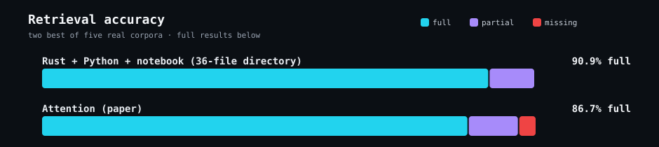
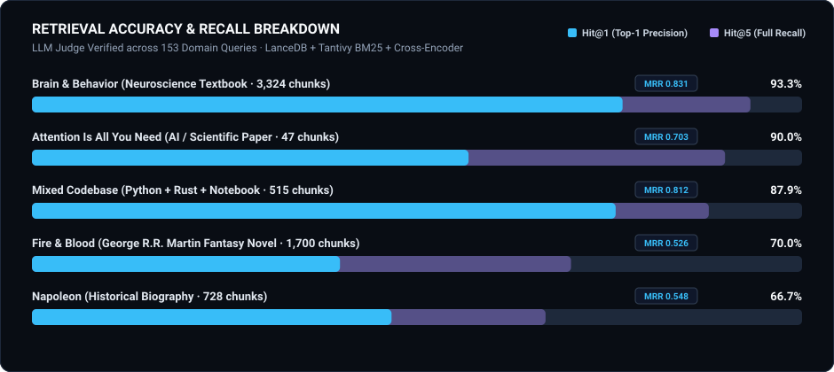
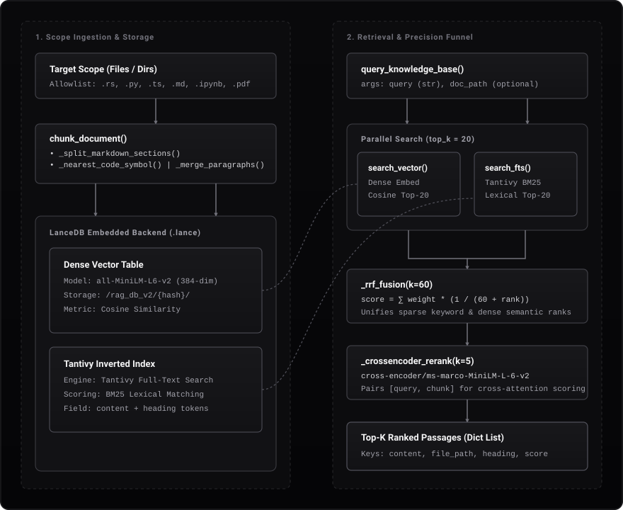

<div align="center">



<br>

[](#quick-start)
[](https://rag.masihmoafi.com)
[](#what-sets-this-apart)
[](#architecture)
[](LICENSE)

**A coding agent should not have to choose between opening files one at a time and dumping an entire repository into context.**

[Live Web Demo](https://rag.masihmoafi.com) • [Install](#quick-start) • [Evals](#benchmark--retrieval-evaluations) • [Architecture](#architecture) • [How it works](#how-it-works) • [Deep-Dive Post](https://masihmoafi.com/projects/rag-mcp)

</div>

## Repository Layout

The command-line interface, MCP server, and retrieval engine are one project in this
checkout. Installing `ragmcp` provides the `rag` command; there is no separate
`rag-cli` source directory to launch.

```text
rag-mcp/
├── rag/                                # Retrieval engine and adapters
│   ├── core.py                         # RAGPipeline composition and search
│   ├── fetch.py                        # Scoped pipeline cache and query entry points
│   ├── discovery.py                    # Path resolution and bounded file discovery
│   ├── formats.py                      # Shared discovery allowlist
│   ├── parsing.py                      # Extraction dispatch and legacy method adapters
│   ├── parsers/                        # Named readers: text, pdf, json, notebook, office/OCR
│   ├── chunking.py                     # Source-preserving chunks and heading labels
│   ├── ingestion.py                    # Indexing, source locations and persisted documents
│   ├── bm25.py                         # In-memory lexical ranking for the Qdrant path
│   ├── reranking.py                    # Rank fusion and configured reranker inference
│   ├── embeddings.py                   # Embedding-provider and ONNX reranker adapters
│   ├── lancedb_backend.py              # Vector storage and Tantivy FTS
│   ├── qdrant_backend.py               # Alternative vector storage
│   └── notebook_chunker.py             # Compatibility imports for notebook metadata readers
│
├── tests/                              # Pytest automated test suite
│   ├── unit/                           # Chunking logic, breadcrumb generation & GPU guardrail unit tests
│   ├── integration/                    # LanceDB CRUD, MCP tool contracts, OCR & file scope tests
│   └── benchmarks/                     # GPU empirical throughput sweeps & OOM ladder benchmarks
│
├── evals/                              # Evaluation Datasets & Scaling Experiments
│   ├── datasets/                       # 8 Clean ground-truth evaluation corpora & CSV query files
│   │   ├── attention/                  # Attention Is All You Need (AI / scientific paper)
│   │   ├── brain-and-behavior/         # Neuroscience textbook (dense structured academic text)
│   │   ├── fire-and-blood/             # George R.R. Martin fantasy novel (narrative fiction)
│   │   ├── napoleon/                   # Historical biography & philosophy
│   │   ├── mixed-codebase/             # Multi-language codebase (Python, Rust, Notebooks)
│   │   ├── elpis-memories-crate/       # Rust systems codebase
│   │   └── notebook/                   # JSON / Jupyter scientific notebooks
│   └── experiments/                    # Multi-Domain Scaling Benchmarks
│       └── experiment-unified-scaling/ # Scaling experiment logs, candidate outputs & LLM judge evals
│
├── server.py                           # FastMCP server entry point exposing tools to coding agents
└── pyproject.toml                      # Project metadata, dependencies (LanceDB, PyTorch, PyMuPDF)
```

## Benchmark & Retrieval Evaluations

Evaluated against the **[open-rag-eval](https://github.com/vectara/open-rag-eval)** taxonomy ($top\_k=5$, isolated local retrieval with no reranker, local `qwen3-embedding:8b` via Ollama + BM25 hybrid search). Full methodology in [`evals/README.md`](evals/README.md):

| Corpus / Domain | Total Queries | Strict Relevance (Score 3 / Exact) | Lenient Relevance (Score $\ge$ 2 / Full+Partial) | Miss Rate (Score $\le$ 1 / Miss) |
| :--- | :--- | :--- | :--- | :--- |
| **Attention Paper** (Scientific / AI) | 30 | **86.7%** (26/30) | **96.7%** (29/30) | 3.3% (1/30) |
| **Brain & Behavior** (Neuroscience) | 30 | **76.7%** (23/30) | **93.3%** (28/30) | 6.7% (2/30) |
| **Napoleon V2** (1000-char hybrid) | 30 | **66.7%** (20/30) | **90.0%** (27/30) | 10.0% (3/30) |
| **Napoleon V1** (300-char chunks) | 30 | **53.3%** (16/30) | **83.3%** (25/30) | 16.7% (5/30) |
| **Fire & Blood** (Narrative Fiction) | 30 | **46.7%** (14/30) | **80.0%** (24/30) | 20.0% (6/30) |
| **Mixed Codebase** (Py/Rust/IPYNB) | 33 | **90.9%** (30/33) | **100.0%** (33/33) | 0.0% (0/33) |
| **Elpis Memories Crate** (Rust) | 15 | **73.3%** (11/15) | **100.0%** (15/15) | 0.0% (0/15) |
| **rag-mcp Codebase** (Python Server) | 15 | **80.0%** (12/15) | **93.3%** (14/15) | 6.7% (1/15) |
| **Notebook Corpus** (JSON/Code) | 10 | **100.0%** (10/10) | **100.0%** (10/10) | 0.0% (0/10) |
| **Overall Baseline** | **203** | **74.9%** (152/203) | **92.1%** (187/203) | 7.9% (16/203) |

### Multi-Domain Scaling Experiment

Detailed evaluation log: [`evals/experiments/experiment-unified-scaling/experiment.md`](evals/experiments/experiment-unified-scaling/experiment.md) and [`Napoleon Experiment Log`](evals/experiments/experiment-unified-scaling/data/napoleon/experiment_log.md).

Evaluated across **5 merged heterogeneous domains (6,314 chunks in a single index)** comparing isolated baselines against unified scaling on NVIDIA GPU with `qwen3-embedding:0.6b` + `cross-encoder/ms-marco-MiniLM-L-6-v2` reranker:

| Corpus / Domain | Queries | Isolated Baseline Hit@5 | Unified Scaled Hit@5 | Isolated Baseline MRR | Unified Scaled MRR | Domain Purity in Unified |
| :--- | :---: | :---: | :---: | :---: | :---: | :---: |
| **Attention Paper** (Scientific / AI) | 30 | **90.0%** (27/30) | **90.0%** (27/30) | 0.803 | 0.803 | 96.7% |
| **Brain & Behavior** (Neuroscience) | 30 | **93.3%** (28/30) | **93.3%** (28/30) | 0.831 | 0.831 | 94.7% |
| **Napoleon Biography** (History / Phil) | 30 | **66.7%** (20/30) | **66.7%** (20/30) | 0.558 | 0.548 | 100.0% |
| **Fire & Blood** (Narrative Fiction) | 30 | **46.7%** (14/30) | **46.7%** (14/30) | 0.372 | 0.372 | 100.0% |
| **Mixed Codebase** (Py/Rust/IPYNB) | 33 | **87.9%** (29/33) | **87.9%** (29/33) | 0.812 | 0.812 | 100.0% |
| **Overall Experiment 1 Total** | **153** | **77.1%** (118/153) | **77.1%** (118/153) | **0.675** | **0.673** | **98.4%** |

*Key finding: Merging 5 domains into one 6,314-chunk database produces **0.0% retrieval degradation** with **98.4% domain isolation purity** and **368ms average latency**.*

> [!TIP]
> Read the complete architectural walkthrough and benchmark breakdown on the [official blog post](https://masihmoafi.com/projects/rag-mcp).

<br>

## Quick start

Exact-word search (BM25) is always on. `rag setup` first asks where retrieval embeddings should run, then shows only the models that source reports: Ollama models already installed here, a supported local CPU catalog, OpenRouter/OpenAI/Google Gemini catalogs, another compatible endpoint, a local model, or exact words only. The default install is light: no PyTorch. This choice controls retrieval; Studio or the MCP host app chooses the answer LLM.

Prerequisite for every path: [`uv`](https://docs.astral.sh/uv/getting-started/installation/), the Python package runner. The npm package is a thin launcher that calls it. The same engine powers the hosted [RAG Studio](https://rag.masihmoafi.com) through `rag studio`.

```bash
uvx ragmcp setup                                    # pick an embedding model once
uvx ragmcp query "What changed?" --path ./docs       # any file or folder
```

```bash
npx ragmcp setup                                    # same, from the Node ecosystem
pnpm dlx ragmcp query "What changed?" --path ./docs
```

Install permanently and use plain `rag`:

```bash
uv tool install ragmcp        # or: pipx install ragmcp · npm install -g ragmcp
rag                           # interactive menu: ↑/↓ to choose, Enter to select
rag setup                     # choose a provider first, then one of its real embedding models
rag setup --auto              # take the recommendation without questions
rag doctor
rag query "What changed?" --path /absolute/path/to/document-or-folder --top3
rag connect codex             # or: claude, copilot, gemini or agy (registers the MCP server)
rag studio                    # pair the hosted Studio; --studio-url http://localhost:3000 for a local checkout
```

Run `rag` from any directory after installing the tool. Use ↑/↓ and Enter to select providers, models, settings, apps, and files or folders. Escape goes back; typing is reserved for the final “enter a path/model ID” option. Completed actions return to the main menu. Piped input retains numbered choices for scripts; model-list positions follow discovery, so use explicit command flags for automation.

The provider-first picker lists only sources detected on the machine or explicitly supported by the CLI. Selecting Ollama opens the embedding models reported by its `/api/show` capabilities; selecting an API provider loads that provider's live embedding catalog. “Local CPU” opens FastEmbed's supported-model catalog and labels download sizes. Custom server URLs and model identifiers are requested only in their dedicated final-entry flows, with the required format shown in the question.

`--top N` (or `--top3`, `--top-5`) sets how many passages a query returns. `rag connect claude --scope project` writes `.mcp.json` in the current folder instead of the user config. Registration always uses a command that outlives the current process: `rag mcp` when installed, or `uvx --from ragmcp==<version> rag mcp` when launched through npx/uvx.

### Change settings later: CLI, menu, or chat

```bash
rag config show                                   # embedding, passages per query, reranker, config file
rag config top 5                                  # how many passages a query returns (the default for --top)
rag config reranker off|auto|fastembed|<model>    # fastembed = a small ONNX cross-encoder, no PyTorch
rag config embedding qwen3-embedding:0.6b         # provider guessed: Ollama here; BAAI/... → local ONNX; text-embedding-3-small → OpenAI key
```

The same three settings are in the `rag` menu ("Change settings"), and `rag connect claude` / `rag connect codex` install a `/rag` command in the agent (Claude Code: `/rag top5`, `/rag --reranker fastembed`, `/rag embedding bge-m3`, or plain words like `/rag use the ollama model`; Codex: `/prompts:rag …`). The MCP server also exposes `get_rag_settings` and `set_rag_settings`, so any agent can change these when asked in chat. API keys are never taken through chat; `rag setup` in a terminal handles them.

`rag setup --provider <none|fastembed|ollama|openai_compatible|sentencetransformer> [--model M] [--base-url URL] [--api-key KEY] [--ollama-url URL]` sets the same choice without questions. The saved choice lives in `~/.config/rag/config.json` (owner-readable only); `RAG_MCP_EMBED_*` environment variables override it per process.

Extras: `ragmcp[full]` adds PyTorch, sentence-transformers and the cross-encoder reranker (GPU); `ragmcp[office]` parses DOCX/PPTX/XLSX/CSV; `ragmcp[ocr]` reads images and scanned PDFs; `ragmcp[qdrant]` adds the Qdrant backend; `ragmcp[anthropic]` enables contextual retrieval. With npm: `RAGMCP_EXTRAS=full npx ragmcp ...`.

`rag studio` starts an authenticated loopback companion and opens the hosted Studio. Keep this terminal open while the browser uses local documents and embeddings. Generation provider/model selection belongs in Studio; an MCP host similarly owns its chat model. `rag query` exercises this repository's Python retrieval engine directly.

### Before it is on npm and PyPI: test from this checkout

The launcher and the engine run exactly as they will after publishing, only from the locally built files:

```bash
cd rag-mcp && uv build && (cd npm && npm pack)                       # dist/ragmcp-0.2.0-py3-none-any.whl and npm/ragmcp-0.2.0.tgz
export RAGMCP_UVX_FROM=$PWD/dist/ragmcp-0.2.0-py3-none-any.whl       # tell the launcher where the engine is
npx --yes file:$PWD/npm/ragmcp-0.2.0.tgz                             # the menu
npx --yes file:$PWD/npm/ragmcp-0.2.0.tgz setup --auto
npx --yes file:$PWD/npm/ragmcp-0.2.0.tgz query "What changed?" --path README.md --top3
npx --yes file:$PWD/npm/ragmcp-0.2.0.tgz connect claude              # or: connect codex
bash tests/install/run.sh                                            # the full install matrix in Docker (npm -g, npx, pnpm dlx, uv tool, every setup path)
```

If you rebuild the wheel at the same version, remove uv's cached environment for it first (`rm -rf ~/.cache/uv/archive-v0/<dir containing ragmcp-0.2.0.dist-info>`), otherwise uvx keeps running the previous build.

### From a checkout

```bash
git clone https://github.com/MasihMoafi/rag-mcp
cd rag-mcp
python scripts/bootstrap.py       # uv sync --all-extras --group dev, then the test suite
uv run rag doctor
```

Manual test equivalent:

```bash
uv sync --all-extras --group dev
.venv/bin/python -m pytest tests/ -v
```

Any MCP client can register the stdio server as the command `rag` with the single argument `mcp` (after `uv tool install ragmcp`), or as `uvx` with arguments `ragmcp mcp` without installing.

### Claude Code

```bash
claude mcp add rag -s user -- rag mcp
```

### Elpis

**Option A: Global Config (`~/.elpis/config.toml`)**

```toml
[mcp_servers.rag]
command = "rag"
args = ["mcp"]

[mcp_servers.rag.env]
RAG_MCP_WORKSPACE_ROOT = "/absolute/path/to/your/workspace"
```

**Option B: Standard MCP JSON (`.mcp.json` or `~/.elpis/mcp.json`)**

```json
{
  "mcpServers": {
    "rag": {
      "type": "stdio",
      "command": "rag",
      "args": ["mcp"],
      "env": {
        "RAG_MCP_WORKSPACE_ROOT": "/absolute/path/to/your/workspace"
      }
    }
  }
}
```

From a checkout, use `/absolute/path/to/rag-mcp/.venv/bin/python /absolute/path/to/rag-mcp/server.py` as the command instead.

### Codex

```bash
rag connect codex
```

Expected result: the client discovers `query_knowledge_base`, and a query returns ranked passages with source paths from the requested scope.

## What is rag-mcp

`rag-mcp` is a local hybrid-search MCP server: point it at a file or folder, ask a question in plain language, and get back the passages that actually answer it — with the exact file and location, not a guess.

Coding agents normally search a codebase by opening files one at a time or dumping an entire repository into the conversation. Both waste time and context. `rag-mcp` replaces that with one tool call: search by meaning, get ranked results with sources, keep going. Embeddings, vector search, and reranking all run locally; the server exposes one read-only MCP tool to compatible clients.

No third-party logo or benchmark — the image above is the actual [retrieval-accuracy evidence](#retrieval-accuracy) this repo ships, not decoration.

## Retrieval accuracy



Recorded, reproducible retrieval runs live under [`evals/`](evals/) — not part of CI, kept
as evidence. Every point in the chart is a question-level grade from a recorded
`query_knowledge_base` run, graded against a known answer — not simulated.

The top result is a single real directory containing
a 29-file Rust crate, 6 Python scripts, and a Jupyter notebook, searched with `doc_path`
pointed at the whole directory — the server has to find the right file among three
languages, not just the right passage in one document. The other five rows are
single-document or project-scoped runs: a notebook, two books, a paper, a novel, and
the rag-mcp codebase itself.

The chart reports exact full answers separately from answers that were full or partial.
The codebase and structured-document rows are easier to retrieve exactly; the long
narrative rows contain more interpretive answers spread across passages, which makes
chunk-based retrieval less reliable. This is a description of these recorded runs, not
a claim about every corpus or a benchmark against other retrieval tools.

[Per-question results for every corpus](evals/) — including where each miss actually failed
(vague topical overlap, a truncated chunk, or the fact genuinely absent from top-k).

An earlier, now-superseded Napoleon run with reranking manually disabled scored 93.3% —
that number describes raw BM25+vector retrieval in isolation, not this server as it actually
runs, and is kept in [`evals/napoleon/experiment_log.md`](evals/napoleon/experiment_log.md)
only for its chunk-size finding (1000 characters beat 300). The earlier separate Rust-only
and notebook-only runs are likewise superseded by the combined directory test above and kept
under `evals/elpis-memories-crate/` and `evals/notebook/` only as raw evidence.

This is six recorded corpora at one point in time — not a benchmark against other
retrieval tools.

## The problem

Coding agents commonly retrieve context by either opening files one by one or loading a large portion of the repository. The first can miss relevant files; the second consumes context with material the current task may not need.

`rag-mcp` moves retrieval into one local tool call so the agent can search by meaning without making the entire tree part of every prompt.

## Architecture



The retrieval pipeline operates across two decoupled stages:

1. **Scope Ingestion & Storage**: Discovery selects allowed files; format readers extract text; `chunking.chunk_document` produces source-preserving chunks. Markdown headings establish section boundaries; code symbols receive best-effort regex labels, not AST parsing. PDF page and notebook cell separators support location recovery, but do not guarantee chunk boundaries. HTML extracts static text while excluding scripts, styles, navigation, templates and explicitly hidden elements; physical source lines are retained for citations. It does not execute JavaScript or interpret CSS visibility. Other plain-text formats retain source syntax. Chunks are indexed for exact-word search and, when an embedding model is configured, dense retrieval.
2. **Retrieval & Precision Funnel**: Each `query_knowledge_base` invocation runs BM25 and, when configured, dense vector search. Candidates are unified via Reciprocal Rank Fusion (`RRF`, `k=60`), then optionally reranked according to the saved retrieval setting before ranked source citations are returned.

Use `rag.core.RAGPipeline` and `rag.fetch.query_documents` for new Python callers.
`RAGPipelineV2`, `fetchExternalKnowledge`, and the original core chunk/BM25 imports
remain compatibility entry points. Parser functions can also be imported directly,
for example `rag.parsers.pdf.extract_pdf_text`; importing one reader does not load
unrelated formats. Existing pipeline extraction overrides are retained.

## How it works

Repository structure:

```text
rag-mcp/
├── server.py       # stdio JSON-RPC MCP host
├── rag/            # chunking, BM25, vector search, reranking
└── utils/proxy.py  # local proxy-environment handling
```

Technical boundaries:

- one MCP tool: `query_knowledge_base(query, doc_path?)`;
- default embeddings: none until `rag setup` (BM25 remains available immediately);
- reranking: `auto` (uses a local cross-encoder when the full extra is installed, otherwise off; overridable);
- local embedded/on-disk LanceDB by default, with Qdrant as an optional backend;
- `doc_path` can scope each call to a file or directory;
- per-path indexes are persisted under the user data directory (`~/.local/share/rag/index`, or `RAG_MCP_DATA_DIR`);
- common large/build directories such as `.git`, `node_modules`, `.venv`, `dist`, `build`, and `target` are rejected;
- configurable depth/token limits fail explicitly instead of scanning an unbounded tree.

### Configuration

Every retrieval knob is an environment variable, not a source edit. Unset means the
default shown:

| Variable | Default | What it controls |
| --- | --- | --- |
| `RAG_MCP_EMBED_PROVIDER` | `none` | `sentencetransformer` (local), `fastembed` (local CPU), `ollama` (local server), or `openai_compatible` (remote — see below) |
| `RAG_MCP_EMBED_MODEL` | unset | embedding model name, meaning depends on provider |
| `RAG_MCP_EMBED_API_KEY` | unset | API key, only used by `openai_compatible` |
| `RAG_MCP_EMBED_BASE_URL` | unset (official OpenAI endpoint) | override endpoint, only used by `openai_compatible` |
| `RAG_MCP_RERANKER_TYPE` | `auto` | `auto`, `fastembed`, or `off` |
| `RAG_MCP_RERANKER_MODEL` | unset | optional model override for the selected reranker |
| `RAG_MCP_CONTEXTUAL_RETRIEVAL` | `off` | `on` or `off`; enrich chunks with document context before indexing |
| `RAG_MCP_CONTEXTUAL_MODEL` | `claude-haiku-4-5` | Anthropic model used for contextualization |
| `RAG_MCP_CONTEXTUAL_MAX_TOKENS` | `128` | maximum generated context per chunk |
| `RAG_MCP_CONTEXTUAL_TIMEOUT` | `30` | Anthropic request timeout in seconds |
| `RAG_MCP_CONTEXTUAL_SOURCE_MAX_CHARS` | `12000` | use bounded chunk context above this source size |
| `RAG_MCP_CONTEXTUAL_START_CHUNKS` | `2` | initial chunks included for large sources |
| `RAG_MCP_CONTEXTUAL_PREV_CHUNKS` | `2` | preceding chunks included for large sources |
| `RAG_MCP_TOP_K` | `5` | candidates pulled from vector search before fusion |
| `RAG_MCP_RERANK_TOP_K` | `5` | results kept after reranking |
| `RAG_MCP_CHUNK_SIZE` | `700` | characters per chunk before overlap |
| `RAG_MCP_CHUNK_OVERLAP` | `100` | characters shared between adjacent chunks |
| `RAG_MCP_RRF_K` | `60` | Reciprocal Rank Fusion constant |
| `RAG_MCP_MAX_DEPTH` | `20` | directory-scan depth limit |
| `RAG_MCP_MAX_TOKENS` | `2000000` | directory-scan size limit |

Contextual retrieval is off by default. Enable it with `rag config contextual on` or
`RAG_MCP_CONTEXTUAL_RETRIEVAL=on`; install `ragmcp[anthropic]` and set
`ANTHROPIC_API_KEY` before indexing. Turning it off changes the index stamp and rebuilds
an uncontextualized index.

The shipped defaults use BM25 alone until a provider and embedding model are selected, so first use never downloads a model or sends text anywhere unexpectedly.

To run the higher-capacity pipeline evaluated in the benchmark suite above, switch to Ollama Qwen embeddings:

```toml
[mcp_servers.rag.env]
RAG_MCP_WORKSPACE_ROOT = "/absolute/path/to/your/project"
RAG_MCP_EMBED_PROVIDER = "ollama"
RAG_MCP_EMBED_MODEL = "qwen3-embedding:8b"
```

`openai_compatible` is the one non-local option: it leaves the machine. One client
implementation covers real OpenAI, Ollama's own `/v1` endpoint, and Qwen/DashScope's and
Gemini's OpenAI-compatible modes — install the optional `openai` package
(`uv sync --extra openai`), then set `RAG_MCP_EMBED_PROVIDER=openai_compatible`,
`RAG_MCP_EMBED_MODEL` to the provider's model name, `RAG_MCP_EMBED_API_KEY`, and
`RAG_MCP_EMBED_BASE_URL` if the provider isn't OpenAI itself. The client construction is
verified; a real embedding call against a paid provider is not — test it against your own
key before trusting it. A cross-encoder reranker type named `llm` also exists in the code
but its scoring is unimplemented scaffolding (every passage gets the same score) — do not
set it, it does nothing useful.

## Current state

### Readiness audit — 2026-09-13

At `18606ea`, the selected offline/local regression suite passes 502 tests in
50.62 seconds, with 476 existing LanceDB deprecation warnings and no expected
failures. This verifies the
covered extraction/citation, API response handling, scope, cache, CLI/MCP and
LanceDB lifecycle cases—not universal production readiness. API tests use an
in-memory HTTP transport with the real SDK and storage, not paid-provider inference.
A separate live OpenRouter/Qwen3-Embedding-8B probe returned 4096 dimensions and
reported $0.00000003 usage cost. Subsequent public-paper retrieval experiments
used the API embeddings with local reranking; results and limitations are below.

Remaining gates:

Extraction failures now abort a refresh instead of silently dropping unreadable
files from an otherwise readable corpus. Text, JSON, notebook and damaged-PDF
preservation/repair checks pass on both local storage backends. PDF extraction can
still recover through a nonempty fallback; genuinely empty successful extraction
is distinct from an exception. Direct parser callers must now handle read/decode
exceptions rather than expect an empty string or list on failure.
Managed indexes use parser stamp 7 and rebuild older generations on next use;
API-backed indexes can incur re-embedding costs. Failed rebuilds preserve the
previous generation but do not silently serve its incomplete results. The complete
unit suite is included in the combined regression run above, alongside the parser
failure and legacy-index migration checks; this does not certify OCR model quality.

- CLI/MCP and direct-engine refreshes now share isolated generation builds and publish
  an atomic pointer only after storage, metadata and the source manifest succeed.
  Both backends preserve the old searchable generation after injected embedding,
  metadata, manifest and pointer-publication failures, including reopen and retry.
  Corrupt-metadata recovery also stages a replacement; injected recovery failures
  preserve the previous stored evidence. Overlapping publication is guarded by a
  short file lock and generation check: a losing refresh raises a retry error
  instead of overwriting the winner (thread and spawned-process tests pass).
  Source revisions are rechecked before publication; detected edits/deletions/additions
  reject the build. This metadata check is not an immutable content snapshot.
  Cache reset drains active searches before closing storage; Qdrant reopen and
  parallel-query draining tests pass. In-process same-scope initialization is
  serialized, independent scopes can initialize together, and ranking-only
  replacement reopens Qdrant without document re-embedding. Reset waits for
  already-started initialization. Direct constructors/other processes do not
  share this cache. Abrupt process exit immediately before/after publication
  leaves the old/new index searchable without reindexing on both backends.
  Process exit after a storage batch also preserves the previously published index.
  POSIX metadata publication now synchronizes the parent directory after rename;
  failures are surfaced and published evidence is retained. Other crash points
  and full database power-loss durability remain unverified.
  The process cache targets eight pipelines (`RAG_MCP_CACHE_SIZE`, minimum one),
  retiring least-recently-acquired idle scopes on subsequent acquisitions. Active
  searches, contended scopes and failed cleanup can temporarily exceed this target;
  this is not a hard memory cap. Cached-pipeline callers must reacquire after
  retirement; the query wrapper retries one pre-search retirement automatically.
  On-disk generations are retained; bounded disk retention is unfinished.
  Retiring a loaded reranker collects unreachable Python cycles after releasing
  pipeline references. A real MiniLM/CUDA check reduced live allocation from about
  100 MB to 9 MB on close; allocator-reserved memory remained available for reuse.
  Collection is process-wide and can add retirement latency; it is not run per query.
- Qwen reranking uses the selected compute device, requests only final-token logits,
  and disables unused attention caching. Tiny real-Qwen CPU tests preserve scores;
  pretrained-model memory/throughput and Apple hardware remain unverified. Inputs
  now use an 8192-token budget including the scoring prompt, following the
  [Qwen reference example](https://huggingface.co/Qwen/Qwen3-Reranker-0.6B), instead
  of discarding passage text after 1000 characters. Cached-tokenizer tests cover
  longer passages and oversized queries; they do not prove ranking quality.
  Long queries can exhaust the passage budget. Inference processes at most eight
  candidates per batch, scores all candidates before ranking, and preserves fused
  order if any batch fails. Tiny real-model tests compare batched scores against
  an all-candidate reference. This is not a total memory cap: longer inputs and
  concurrent searches can still increase memory use and latency.
- Realistic retrieval-quality evaluation of the current hybrid/API path, including
  larger private corpora; the new HTML reader currently has fixture-level coverage.
- The fec0e03 source distribution and wheel built offline and installed into a
  fresh Linux/Python 3.13 environment without PyTorch. Installed CLI retrieval,
  separate-process reopen and MCP stdio retrieval passed with correct citations
  and Python socket connections blocked. All36 runtime Python files byte-match
  the tested wheel. Other platforms/Python versions,
  optional model backends and GPU throughput remain unverified. Optional
  DOCX/PPTX/XLSX/CSV and image-OCR fixture tests subsequently passed on this host
  with socket connections blocked; complex layouts, scanned PDFs and clean
  installation of these optional dependencies remain unverified.

The [public-paper evaluation record](evals/calibration/attention-support-review.json)
includes a 30-question hybrid retrieval run using Qwen3 API embeddings and a local
MiniLM reranker (20 candidates per retrieval channel, five final passages).
Caption-aware PDF boundaries improved manually reviewed answer support from
24 full / 4 partial / 2 missing to **26 full / 3 partial / 1 missing**, with about
3.1% less returned text. Literal containment stayed at 11/30: it is not a
relevance score. This is one public paper, assistant-reviewed and not blinded;
it does not establish general production quality. Remaining misses include
interpretability, incomplete explanations and table context. Cumulative
provider-reported embedding spend was $0.00037691, not an independent billing audit.

### Implemented and verified

- MCP `initialize` → `tools/list` → `tools/call` protocol path.
- Read-only `query_knowledge_base` tool.
- Workspace-root and explicit `doc_path` scoping.
- Local hybrid retrieval and reranking.
- Guardrails for excluded directories and oversized scopes.
- Text extraction for PDF and Jupyter notebooks, plus local OCR for common image
  formats and structured extraction for DOCX, PPTX, XLSX, and CSV files.
- End-to-end registration was exercised through a real MCP client during development.

### Provider verification limits

- Ollama and other provider/model combinations are not covered by the readiness
  suite above; do not extrapolate the OpenRouter result to every provider.
- The `openai_compatible` path has real OpenRouter embedding evidence as described
  above. Rate-limit, authentication and server-error recovery tests use simulated
  HTTP responses; they do not establish a live provider's availability or latency.

### Planned

The remaining readiness gates above track unfinished reliability and retrieval
work. Per-question evidence and unresolved retrieval failures are recorded in
`evals/calibration/`; passing one document's evaluation is not a release guarantee.

### Intentionally unsupported

- Hosted/remote vector databases.
- File types outside the extension allowlist in `server.py`.
- Write/mutation tools; this server is retrieval-only.

## What sets this apart

These are design choices, not novelty claims:

- **Local storage and search:** source files and vector indexes stay on the machine.
  Local embedding models keep passage processing local; API embedding providers
  send passage and query text to the configured endpoint. Optional API contextual
  enrichment also sends text externally. Choose providers accordingly for private data.
- **Small transport layer:** the MCP host uses direct stdio JSON-RPC rather than depending on an MCP SDK.
- **Per-call scope:** one server can search different files/directories instead of requiring one fixed knowledge base per project.
- **Evidence in the response:** returned chunks include source paths rather than only synthesized prose.

## Evals and test series

The test suite lives under `tests/`:

```bash
python scripts/bootstrap.py
```

They cover:

- read-only tool annotations;
- default workspace scoping;
- explicit `doc_path` scoping;
- rejection of excluded directories;
- rejection of depth-limit violations;
- bootstrap prerequisite checks;
- extraction from DOCX, PPTX, XLSX, and CSV files;
- local OCR extraction from a generated image fixture.

Protocol-level check, without another MCP client:

```bash
printf '%s\n%s\n%s\n' \
  '{"jsonrpc":"2.0","id":1,"method":"initialize","params":{"protocolVersion":"2025-06-18"}}' \
  '{"jsonrpc":"2.0","id":2,"method":"tools/list"}' \
  '{"jsonrpc":"2.0","id":3,"method":"tools/call","params":{"name":"query_knowledge_base","arguments":{"query":"how does reciprocal rank fusion combine bm25 and vector results"}}}' \
  | RAG_MCP_WORKSPACE_ROOT="$PWD" .venv/bin/python server.py
```

A successful self-query should return evidence pointing at rank fusion in `rag/reranking.py`.

What the tests prove: MCP transport/scoping/guardrail behavior covered by those cases.

What they do **not** prove: retrieval quality across arbitrary corpora, cross-client compatibility, or superiority to grep/code-search/RAG alternatives.

## Example

```text
query_knowledge_base(
  "how does retry backoff work for failed jobs",
  doc_path="codex-rs/memories"
)
```

The response is intended for the calling agent: ranked source passages it can use as task context rather than a standalone chat answer.

## Future development

Keep the surface small. Add capability only when real usage shows a retrieval, compatibility, or performance gap worth testing.

## License

MIT — see [LICENSE](LICENSE).
