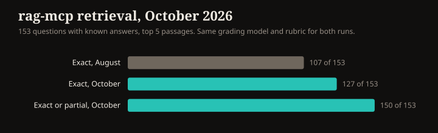
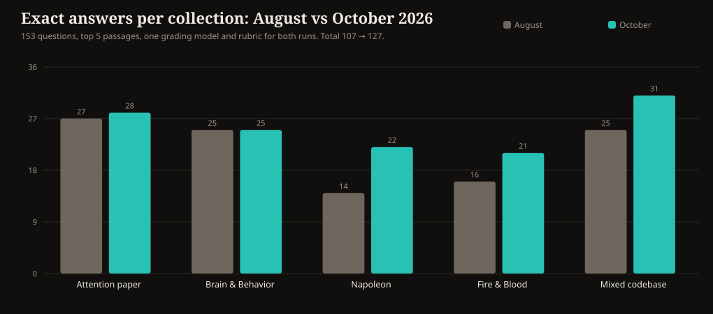
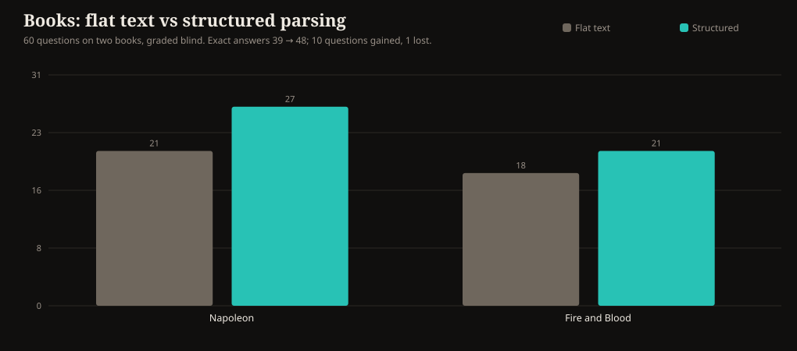

<div align="center">



<br>

[](#quick-start)
[](#design-choices)
[](#how-it-works)
[](LICENSE)

**A coding agent should not have to choose between opening files one at a time and dumping an entire repository into context.**

Beta · v0.2.0 · Linux (verified; Python 3.13)

[Install](#quick-start) • [Evals](#benchmark--retrieval-evaluations) • [How it works](#how-it-works) • [Deep-Dive Post](https://masihmoafi.com/projects/rag-mcp)

</div>

## Quick start

```bash
curl -LsSf https://raw.githubusercontent.com/MasihMoafi/rag-mcp/main/install.sh | sh
rag setup
rag query "What changed?" --path ./docs
```

The installer adds [uv](https://docs.astral.sh/uv/) if it is missing (uv provides Python), then the `rag` command.
Tested on Linux. Studio is not included in this release.

Exact-word retrieval works without a key. Answer synthesis sends the question and
selected evidence to OpenRouter and needs an OpenRouter key (`rag key set` or
`OPENROUTER_API_KEY`). When an OpenRouter key is available, hosted reranking is
enabled by default and sends the query and candidate passages to OpenRouter; use
`rag config reranker off` to disable it. Hosted embedding and optional contextual
retrieval also send text to their configured providers. Source files and indexes
remain local. FastEmbed may download models unless `HF_HUB_OFFLINE=1` or
`TRANSFORMERS_OFFLINE=1` is set. Replace `./docs` with a path that exists.

On success, a query prints an answer from the selected scope.

<details>
<summary>More commands and client setup</summary>

```bash
rag                           # print help
rag setup --auto              # take the recommendation without questions
rag doctor
rag query "What changed?" --path /absolute/path/to/document-or-folder --top3
rag workspaces --json          # list local workspaces
rag search "What changed?" --workspace personal  # retrieve passages without an answer model
rag query "What changed?" --workspace personal --top 3
rag connect codex             # or: claude, copilot, gemini or agy (registers the MCP server)
```

Bare `rag` prints help. `rag setup` offers an interactive provider picker. Use explicit command flags for automation.
Run the installer again to update. `RAGMCP_EXTRAS=office` (or `full`, `qdrant`, `anthropic`) before `sh` adds
extras; `RAGMCP_REF` installs a tag or branch.

### From a checkout

```bash
git clone https://github.com/MasihMoafi/rag-mcp
cd rag-mcp
python scripts/bootstrap.py       # uv sync --all-extras --group dev, then the test suite
uv run rag doctor
```

Manual test equivalent:

```bash
uv sync --all-extras --group dev
.venv/bin/python -m pytest tests/ -v
```

Any MCP client can register `rag mcp` once `rag` is installed.

### Claude Code

```bash
claude mcp add rag -s user -- rag mcp
```

### Any MCP client

Clients that accept standard MCP JSON can use:

```json
{
  "mcpServers": {
    "rag": {
      "type": "stdio",
      "command": "rag",
      "args": ["mcp"]
    }
  }
}
```

From a checkout, use `/absolute/path/to/rag-mcp/.venv/bin/python /absolute/path/to/rag-mcp/server.py` as the command instead.

### Codex

```bash
rag connect codex
```

Expected result: the client discovers `query_knowledge_base`, and a query returns
only a readable answer from the requested document scope.

</details>

## What it is

`rag-mcp` is an answer-producing hybrid RAG CLI and MCP server. Point it at an
explicit supported file or narrow directory, ask a question in plain language,
and receive a grounded answer without retrieval internals in the public result.

The source documents and vector index remain local. The configured Qwen embedding,
Cohere reranking, and DeepSeek synthesis calls use OpenRouter. The answer tool keeps
retrieved chunks and scores out of its response; a shared conversation also returns
run and conversation IDs. `rag search` can return passage text and scores; MCP
workspace search returns them when `include_content: true` is set.

## Why it exists

Coding agents commonly retrieve context by either opening files one by one or loading a large portion of the repository. The first can miss relevant files; the second consumes context with material the current task may not need.

`rag-mcp` moves retrieval and answer synthesis behind one scoped tool call so the
agent does not receive the source tree or intermediate chunks in its context.

## Core features

- **Scoped retrieval.** Search an explicit file, narrow folder, or saved workspace; [scope tests](tests/integration/test_rag_scope.py) cover the boundary.
- **Hybrid search.** Combine BM25 and embeddings, fuse ranks, and rerank; the [retrieval evaluation](evals/experiments/report-2026-10-28/) records results on 153 questions.
- **Document readers.** Read PDF, HTML, notebooks, and optional office formats; see the [format allowlist](rag/formats.py).
- **CLI and MCP.** Ask through `rag` or an MCP client; [MCP host tests](tests/integration/test_rag_mcp_host.py) exercise the server.
- **Shared workspaces.** CLI and MCP share sources and revisions; see the [workspace store](rag/workspaces.py).
- **Answer boundary.** The answer-only decoder rejects malformed results and unexpected fields; see [its implementation](rag/answer_contract.py).

## How it works

<a id="architecture"></a>

### Answer pipeline

The approved hosted profile uses BM25 plus OpenRouter `qwen/qwen3-embedding-4b`, fuses
the best 50 candidates with RRF, asks `cohere/rerank-4-fast` for the best five,
then asks `deepseek/deepseek-v4.1-flash` for a concise grounded answer. The CLI
prints that answer. The MCP answer tool returns the answer without private paths, scores, or internal retrieval data.
When requested, the answer can include short quotes and available source references.
PDF page references use file positions. Missing printed page numbers remain unavailable.
A query must name an explicit supported file, a narrow directory, or a saved workspace. Directory queries accept an optional file-type filter.
With no OpenRouter key and no explicit reranker choice, a fresh local profile
keeps reranking off so retrieval-only BM25 search works without provider setup.
Adding a key enables the hosted reranker default; an explicit reranker choice
always takes precedence.

On 22 September 2026, OpenRouter served no endpoint for Qwen3 Reranker 4B or 0.6B. The configured Cohere fallback was verified live at $0.002 per search;
the pipeline still fails clearly rather than silently skipping reranking.

The complete hosted profile was exercised live on 2026-09-22 with 60 synthetic
Markdown chunks: Qwen embedded the corpus and query, RRF supplied 50 candidates,
Cohere returned all 50 scores, five passages reached DeepSeek, and the public
result contained only the correct answer. OpenRouter reported a total cost of
$0.00214904. This is a wiring check, not a retrieval-quality benchmark.

The public answer pipeline operates across three stages:

1. **Scoped ingestion**: The caller supplies one supported file or an explicit narrow directory. An optional extension filter can limit a directory—for example, to `.md` while excluding HTML. Chunks are indexed for BM25 and Qwen3 Embedding 4B dense retrieval.
2. **Precision funnel**: BM25 and dense results are fused with Reciprocal Rank Fusion (`RRF`, `k=60`). At most 50 fused candidates reach Cohere Rerank 4 Fast; it keeps five.
3. **Answer boundary**: DeepSeek V4.1 Flash answers from those five passages. The answer tool returns readable answer text; shared-conversation responses also carry run and conversation IDs.

The answer-only decoder accepts a nonempty `result` string, optionally with a
string `reason`, or a nonempty `error` string. Legacy passage arrays, unexpected
metadata fields, malformed JSON, and empty output fail closed instead of being
serialized to the caller.

Use `rag.core.RAGPipeline` and `rag.fetch.query_documents` for new Python callers.
`RAGPipelineV2`, `fetchExternalKnowledge`, and the original core chunk/BM25 imports
remain compatibility entry points. Parser functions can also be imported directly,
for example `rag.parsers.pdf.extract_pdf_text`; importing one reader does not load
unrelated formats. Existing pipeline extraction overrides are retained.

Repository structure:

```text
rag-mcp/
├── server.py       # stdio JSON-RPC MCP host
├── rag/            # chunking, BM25, vector search, reranking
└── utils/proxy.py  # local proxy-environment handling
```

Approved hosted-profile boundaries:

- answer tool `query_knowledge_base` and retrieval-only `search_workspace` for a saved workspace;
- embeddings: OpenRouter `qwen/qwen3-embedding-4b` plus always-on BM25;
- reranking: OpenRouter `cohere/rerank-4-fast`, with no silent fallback;
- synthesis: OpenRouter `deepseek/deepseek-v4.1-flash`;
- local embedded/on-disk LanceDB by default, with Qdrant as an optional backend;
- each call names a supported file or narrow directory with `doc_path`, or a saved workspace with `workspace_id`;
- per-path indexes are persisted under the user data directory (`~/.local/share/rag/index`, or `RAG_MCP_DATA_DIR`);
- common large/build directories such as `.git`, `node_modules`, `.venv`, `dist`, `build`, and `target` are rejected;
- configurable depth/token limits fail explicitly instead of scanning an unbounded tree.

### Configuration

Pipeline settings can be changed without editing source. The table shows source
defaults; saved settings and `RAG_MCP_*` environment variables override them. The
approved hosted profile uses Qwen3 Embedding 4B even though a clean installation
starts with no embedding model until setup is completed.

| Variable | Default | What it controls |
| --- | --- | --- |
| `RAG_MCP_EMBED_PROVIDER` | `none` | `sentencetransformer` (local), `fastembed` (local CPU), `ollama` (local server), or `openai_compatible` (remote — see below) |
| `RAG_MCP_EMBED_MODEL` | unset | embedding model name, meaning depends on provider |
| `RAG_MCP_EMBED_API_KEY` | unset | API key, only used by `openai_compatible` |
| `RAG_MCP_EMBED_BASE_URL` | unset (official OpenAI endpoint) | override endpoint, only used by `openai_compatible` |
| `RAG_MCP_RERANKER_TYPE` | `off` without an OpenRouter key; `openrouter` with one | Effective default when no explicit choice is saved; explicit choices override it, and hosted provider failures stop the pipeline |
| `RAG_MCP_RERANKER_MODEL` | `cohere/rerank-4-fast` | required hosted reranker |
| `RAG_MCP_CANDIDATE_K` | `50` | fused candidates passed to the reranker |
| `RAG_MCP_ANSWER_MODEL` | `deepseek/deepseek-v4.1-flash` | model that synthesizes the private evidence into an answer |
| `RAG_MCP_CONTEXTUAL_RETRIEVAL` | `off` | `on` or `off`; enrich chunks with document context before indexing |
| `RAG_MCP_CONTEXTUAL_MODEL` | `claude-haiku-4-5` | Anthropic model used for contextualization |
| `RAG_MCP_CONTEXTUAL_MAX_TOKENS` | `128` | maximum generated context per chunk |
| `RAG_MCP_CONTEXTUAL_TIMEOUT` | `30` | Anthropic request timeout in seconds |
| `RAG_MCP_CONTEXTUAL_SOURCE_MAX_CHARS` | `12000` | use bounded chunk context above this source size |
| `RAG_MCP_CONTEXTUAL_START_CHUNKS` | `2` | initial chunks included for large sources |
| `RAG_MCP_CONTEXTUAL_PREV_CHUNKS` | `2` | preceding chunks included for large sources |
| `RAG_MCP_TOP_K` | `50` | candidates pulled from each retrieval channel before fusion |
| `RAG_MCP_RERANK_TOP_K` | `5` | passages kept for synthesis, never returned publicly |
| `RAG_MCP_CHUNK_SIZE` | `700` | characters per chunk before overlap |
| `RAG_MCP_CHUNK_OVERLAP` | `100` | characters shared between adjacent chunks |
| `RAG_MCP_RRF_K` | `60` | Reciprocal Rank Fusion constant |
| `RAG_MCP_MAX_DEPTH` | `20` | directory-scan depth limit |
| `RAG_MCP_MAX_TOKENS` | `2000000` | directory-scan size limit |

In the table, `openai_compatible` can also use a local endpoint, such as Ollama's
`/v1`; a remote endpoint receives the text. The statement that reranked passages
are never returned applies to the answer tool; retrieval-only search has a separate
boundary.

Contextual retrieval is off by default. Enable it with `rag config contextual on` or
`RAG_MCP_CONTEXTUAL_RETRIEVAL=on`; install `ragmcp-cli[anthropic]` and set
`ANTHROPIC_API_KEY` before indexing. Turning it off changes the index stamp and rebuilds
an uncontextualized index.

The embedding default is BM25-only until setup. The answer pipeline still requires
its configured hosted reranker and synthesis model; selecting a local embedding
model does not make the entire answer pipeline local.

To run the higher-capacity pipeline evaluated in the benchmark suite above, switch to Ollama Qwen embeddings:

```toml
[mcp_servers.rag.env]
RAG_MCP_WORKSPACE_ROOT = "/absolute/path/to/your/project"
RAG_MCP_EMBED_PROVIDER = "ollama"
RAG_MCP_EMBED_MODEL = "qwen3-embedding:8b"
```

`openai_compatible` sends text to its configured local or remote endpoint. One client
implementation covers real OpenAI, Ollama's own `/v1` endpoint, and Qwen/DashScope's and
Gemini's OpenAI-compatible modes — the `openai` client is already a core dependency;
set `RAG_MCP_EMBED_PROVIDER=openai_compatible`,
`RAG_MCP_EMBED_MODEL` to the provider's model name, `RAG_MCP_EMBED_API_KEY`, and
`RAG_MCP_EMBED_BASE_URL` if the provider isn't OpenAI itself. The client construction is
verified, and OpenRouter has live embedding evidence described below; other provider
endpoints still need verification. The unsupported `reranker_type=llm` setting is rejected
before resource initialization; it previously returned fusion order without scoring.
Use `openrouter`, `cross-encoder`, `fastembed`, `auto` or `disabled` instead.

### Scope and settings

`rag config context_radius 1` adds one indexed neighbouring chunk on each side
when answering. The default is `0` (off), with a maximum of `3`. Search rankings
and retrieval-only results stay unchanged; changing this setting does not rebuild
the index. Windows use verified source text and are capped at 16,000 characters.

The CLI checks a path's file types and folder-size limits before first-use model
setup. For a saved-page folder containing Markdown chapters plus HTML and asset
copies, use `--type md` deliberately; an oversized mixed folder is rejected
before any model probe or index build.

Folder queries consider supported document formats and, by default, reject scopes with more than
5,000 matching files; select a smaller folder instead of relying on a silently truncated index. Existing file
type, depth, hidden/generated-file and symlink exclusions still apply.
Directory-listing and entry metadata-read errors abort discovery
instead of caching a partial file manifest.

The provider-first picker lists only sources detected on the machine or explicitly supported by the CLI. Selecting Ollama opens the embedding models reported by its `/api/show` capabilities; selecting an API provider loads that provider's live embedding catalog. “Local CPU” opens FastEmbed's supported-model catalog and labels download sizes. Custom server URLs and model identifiers are requested only in their dedicated final-entry flows, with the required format shown in the question.

`--top N` (or `--top3`, `--top-5`) sets how many reranked passages the internal
synthesis step may use; those passages are not returned. `rag connect claude --scope project` writes `.mcp.json` in the current folder instead of the user config. Registration uses `rag mcp`, a command that outlives the current process.

### Change settings later: CLI, menu, or chat

```bash
rag config show                                   # embedding, candidate/final counts, reranker, answer model
rag config top 5                                  # passages available only to answer synthesis
rag config candidates 50                          # candidate count before final selection
rag config answer deepseek/deepseek-v4.1-flash     # OpenRouter answer model
rag config reranker openrouter                    # cohere/rerank-4-fast
rag config embedding qwen/qwen3-embedding-4b       # approved OpenRouter embedding model
rag config embedding local-embedding --runtime "LM Studio"  # detected local model and loopback endpoint
```

`rag connect claude --install-prompt` / `rag connect codex --install-prompt` also install a `/rag` command in the agent (Claude Code: `/rag top5`, `/rag --reranker fastembed`, `/rag embedding bge-m3`, or plain words like `/rag use the ollama model`; Codex: `/prompts:rag …`). The MCP server also exposes `get_rag_settings` and `set_rag_settings`, so any agent can change these when asked in chat. API keys are never taken through chat; `rag setup` in a terminal handles them.

`rag capabilities` (or `--json`) reports the configured lexical, embedding,
reranking, and generation stages. MCP `get_rag_capabilities` reads the same engine report. `unavailable` means disabled
or missing a required known API key; `unknown` means the model or runtime has
not been probed. This read-only report makes no provider request or download
and never returns keys.

`rag models --json`, MCP `get_rag_models`, and the paired gateway's authenticated
`GET /v1/models` explicitly discover configured models, installed Ollama and
local-runtime embedding models, and cached sentence-transformer/FastEmbed models.
Each source is capped at 20 entries and reports whether discovery was truncated
or failed. This is an inventory, not a successful model probe; remote provider
catalogs are not queried, and neither cache paths nor credentials are returned.
Discovery does not change the active model. `rag config embedding MODEL` and MCP
`set_rag_settings` probe a discovered local choice before saving it. For a local
OpenAI-compatible runtime, pass its label with CLI `--runtime` or MCP
`embedding_runtime`; the engine checks the model is advertised there and uses
that runtime's loopback endpoint. Use `rag setup` for arbitrary endpoints or
credential entry.

`rag setup --provider <none|fastembed|ollama|openai_compatible|sentencetransformer> [--model M] [--base-url URL] [--api-key-stdin] [--ollama-url URL]` sets the provider directly. Set `RAG_MCP_EMBED_API_KEY` or pass the key on stdin with `--api-key-stdin`; otherwise a terminal prompts for it without echo. The saved choice lives in `~/.config/rag/config.json` (owner-readable only); `RAG_MCP_EMBED_*` environment variables override it per process.

Extras: `ragmcp-cli[full]` adds PyTorch, sentence-transformers and the cross-encoder reranker (GPU); `ragmcp-cli[office]` parses DOCX/PPTX/XLSX/CSV; `ragmcp-cli[qdrant]` adds the Qdrant backend; `ragmcp-cli[anthropic]` enables contextual retrieval. Install one with `RAGMCP_EXTRAS=full` before `sh` in the install line.

### Shared workspaces

Use `rag sources add <workspace-id> --path ./docs --type md` to import a file or
folder. `rag workspaces <workspace-id> --json` lists source IDs and revisions.
`rag search "Question?" --workspace <workspace-id> --json` retrieves passages
without generating an answer. MCP `search_workspace` returns passage text only
when `include_content` is true. `rag chunks` and MCP `get_workspace_chunks`
provide paged chunk previews with text opt-in. Workspace mutations use revisions
to reject stale changes. See [run inspection and privacy](docs/observability.md).

`rag evaluations`, `rag labels`, and `rag conversations` manage workspace
questions, judgments, and answer conversations. Their MCP counterparts share
the same records.

### Trust boundary

The MCP client is trusted like a shell: by default it can select files readable
by the server process. Set `RAG_MCP_ALLOWED_ROOTS` to a path-separated list of
approved roots to confine MCP document paths; resolved paths must stay inside one
of those roots. Use operating-system permissions and host authorization as well.
Existing workspace contents are controlled by the workspace store, not this path
filter. Documents, returned chunks, and model answers can contain prompt injection;
the host is responsible for treating them as untrusted data and enforcing tool
permissions. Prompt instructions alone cannot guarantee model compliance.

<a id="what-sets-this-apart"></a>

### Design choices

These are design choices, not novelty claims:

- **Local storage and configurable inference:** source files and vector indexes stay on the machine.
  Local embedding models keep passage processing local; API embedding providers
  send passage and query text to the configured endpoint. Optional API contextual
  enrichment also sends text externally. Choose providers accordingly for private data.
- **Small transport layer:** the MCP host uses direct stdio JSON-RPC rather than depending on an MCP SDK.
- **Per-call scope:** one server can search different files/directories instead of requiring one fixed knowledge base per project.
- **Private answer boundary:** the answer tool keeps retrieved chunks, private paths, and scores inside the pipeline. It can include requested quotes and available source references. Workspace search can return locations and requested content.

<a id="retrieval-accuracy"></a>
<a id="benchmark--retrieval-evaluations"></a>

### Benchmark and retrieval evaluations

No third-party logo or benchmark — the image above is the actual [retrieval-accuracy evidence](#retrieval-accuracy) this repo ships, not decoration.

The current measurement is under [Benchmark & Retrieval Evaluations](#benchmark--retrieval-evaluations). Per-question results for every recorded run are under [`evals/`](evals/).

Measured on 28 October 2026: 153 questions with known answers over five collections (a paper, a textbook, a biography, a novel and a mixed Rust, Python and notebook codebase). For each question the top 5 passages were graded **exact** (the rubric asks for a passage that states the answer), **partial** or **miss**. Opus 5.5 subagents used the same rubric to grade this run and regrade the passages saved from August. The [run record](evals/experiments/search-quality-2026-10-28/experiment.md) notes that seven answers split across passages were graded exact and that graders differed on split answers. The report, per-question grades and run traces are in [`evals/experiments/report-2026-10-28/`](evals/experiments/report-2026-10-28/).



| Collection | Questions | Exact, Aug 2026 | Exact, Oct 2026 | Exact or partial, Oct 2026 |
| :--- | :---: | :---: | :---: | :---: |
| Attention paper | 30 | 27 | **28** | 30 |
| Brain and Behavior | 30 | 25 | **25** | 29 |
| Napoleon | 30 | 14 | **22** | 29 |
| Fire and Blood | 30 | 16 | **21** | 30 |
| Mixed codebase | 33 | 25 | **31** | 32 |
| **Total** | **153** | 107 (69.9%) | **127 (83.0%)** | **150 (98.0%)** |

- **Setups.** August: Qwen3 Embedding 0.6B (local), a MiniLM-L6 reranker and 1,000-character chunks. October: BM25 plus Qwen3 Embedding 8B, rank fusion to 50 candidates, Cohere Rerank 4 Fast to 5, and 700-character chunks.
- **Not chance.** 27 questions are exact only in October and 7 only in August (exact sign test, p = 0.0008).
- **Replaced.** The September table of "203 questions" is gone: its rows added up to 223, and its passages were not saved, so it cannot be regraded.

### Structured PDF parsing

Since 28 October, PDFs are read as paragraphs and chapter headings (running headers, page numbers and font ligature glyphs removed), and book-length text is cut in 1,600-character windows. On the two books (60 questions, graded blind) exact answers rose from 39 to 48: 10 questions gained, 1 lost (p = 0.0117). Evidence: [`evals/experiments/structured-chunking-2026-10-28/`](evals/experiments/structured-chunking-2026-10-28/).



### Concurrent queries

A search that arrives while another runs now waits up to 10 minutes instead of failing. With 20 searches started at once, 20 are answered (before: 1). They run one after another, about 4 seconds each. Evidence: [`evals/experiments/concurrency-2026-10-28/`](evals/experiments/concurrency-2026-10-28/).

### Multi-Domain Scaling Experiment (August 2026)

Graded by Gemini 3.7 Flash with a hit-at-5 measure. The October regrade of the same saved passages is in the table above.

Detailed evaluation log: [`evals/experiments/experiment-unified-scaling/experiment.md`](evals/experiments/experiment-unified-scaling/experiment.md) and [`Napoleon Experiment Log`](evals/experiments/experiment-unified-scaling/data/napoleon/experiment_log.md).

Evaluated across **5 merged heterogeneous domains (6,314 chunks in a single index)** comparing isolated baselines against unified scaling on NVIDIA GPU with `qwen3-embedding:0.6b` + `cross-encoder/ms-marco-MiniLM-L-6-v2` reranker:

| Corpus / Domain | Queries | Isolated Baseline Hit@5 | Unified Scaled Hit@5 | Isolated Baseline MRR | Unified Scaled MRR | Domain Purity in Unified |
| :--- | :---: | :---: | :---: | :---: | :---: | :---: |
| **Attention Paper** (Scientific / AI) | 30 | **90.0%** (27/30) | **90.0%** (27/30) | 0.803 | 0.803 | 96.7% |
| **Brain & Behavior** (Neuroscience) | 30 | **93.3%** (28/30) | **93.3%** (28/30) | 0.831 | 0.831 | 94.7% |
| **Napoleon Biography** (History / Phil) | 30 | **66.7%** (20/30) | **66.7%** (20/30) | 0.558 | 0.548 | 100.0% |
| **Fire & Blood** (Narrative Fiction) | 30 | **46.7%** (14/30) | **46.7%** (14/30) | 0.372 | 0.372 | 100.0% |
| **Mixed Codebase** (Py/Rust/IPYNB) | 33 | **87.9%** (29/33) | **87.9%** (29/33) | 0.812 | 0.812 | 100.0% |
| **Overall Experiment 1 Total** | **153** | **77.1%** (118/153) | **77.1%** (118/153) | **0.675** | **0.673** | **98.4%** |

*In this run, merging 5 domains into one 6,314-chunk database produced **0.0% Hit@5 degradation**, **98.4% domain isolation purity**, and **368ms average latency**; MRR changed from 0.675 to 0.673.*

> [!TIP]
> Read the complete architectural walkthrough and benchmark breakdown on the [official blog post](https://masihmoafi.com/projects/rag-mcp).

<br>

### Historical readiness evidence

The dated records below document earlier retrieval-only configurations. They are
retained as historical evidence and do not verify the current Qwen3 Embedding 4B →
Rerank 4 Fast → DeepSeek answer profile unless a paragraph explicitly says so.

### Readiness audit — 2026-09-13

The original README records that at revision `fbafa50` (runtime `6430bc0`), the selected offline/local regression
suite passed all 570 tests in 57.87 seconds, with 530 existing LanceDB deprecation
warnings. This combined rerun includes the corrected source-aware reranker input
expectation and checks for unchanged evidence, citations and reopening. This verifies the
covered extraction/citation, API response handling, scope, cache, CLI/MCP and
LanceDB lifecycle cases—not universal production readiness. API tests use an
in-memory HTTP transport with the real SDK and storage, not paid-provider inference.
A separate live OpenRouter/Qwen3-Embedding-8B probe returned 4096 dimensions and
reported $0.00000003 usage cost. Subsequent public-paper retrieval experiments
used the API embeddings with local reranking; results and limitations are below.

Evidence and remaining limits:

A bounded shared-pipeline replay at `d2d739c` completed 120 searches with four
workers against the existing 79-chunk public-paper index, using cached API query
embeddings and the real local CUDA reranker. All ordered passages/citations matched
the saved baseline. Sequential/concurrent p95 service times were 86/255 ms;
peak allocated CUDA memory rose from 265 MB to 491 MB (decimal). This is one short
local run, not sustained-load, live-provider or large-corpus certification, and
does not establish better retrieval relevance. Raw evidence is in
`/tmp/rag-concurrent-replay-6hxcklqq/results.json` on the audit machine.

Extraction failures now abort a refresh instead of silently dropping unreadable
files from an otherwise readable corpus. Text, JSON, notebook and damaged-PDF
preservation/repair checks pass on both local storage backends. PDF extraction can
still recover through a nonempty fallback; genuinely empty successful extraction
is distinct from an exception. Direct parser callers must now handle read/decode
exceptions rather than expect an empty string or list on failure.
API-backed indexes can incur re-embedding costs. Failed rebuilds preserve the
previous generation but do not silently serve its incomplete results. The complete
unit suite is included in the combined regression run above, alongside the parser
failure and legacy-index migration checks.

- CLI/MCP and direct-engine refreshes now share isolated generation builds and publish
  an atomic pointer only after storage, metadata and the source manifest succeed.
  Both backends preserve the old searchable generation after injected embedding,
  metadata, manifest and pointer-publication failures, including reopen and retry.
  Corrupt-metadata recovery also stages a replacement; injected recovery failures
  preserve the previous stored evidence. Overlapping publication is guarded by a
  short file lock and generation check: a losing refresh raises a retry error
  instead of overwriting the winner (thread and spawned-process tests pass).
  Source revisions are rechecked before publication; detected edits/deletions/additions
  reject the build. This metadata check is not an immutable content snapshot.
  Cache reset drains active searches before closing storage; Qdrant reopen and
  parallel-query draining tests pass. In-process same-scope initialization is
  serialized, independent scopes can initialize together, and ranking-only
  replacement reopens Qdrant without document re-embedding. Reset waits for
  already-started initialization. Direct constructors/other processes do not
  share this cache. Abrupt process exit immediately before/after publication
  leaves the old/new index searchable without reindexing on both backends.
  Process exit after a storage batch also preserves the previously published index.
  LanceDB writes now stream Arrow batches instead of retaining all Python vectors.
  Prior-batch Python vectors are released before the next embedding call; late
  preparation failures preserve the existing table and original exception.
  A paired synthetic run (4,096 records × 4,096 dimensions, batches of512,
  Linux/Python3.13.5/LanceDB0.37.1) reduced write peak RSS from1.23GiB to342MiB
  and took3.55s versus3.00s, with matching stored text/schema and three retrieval
  probes. This single run uses generated vectors, not provider inference or real
  corpus parsing. Input documents and native buffers still occupy memory;
  it is not a total RAM limit or a general throughput guarantee.
  POSIX metadata publication now synchronizes the parent directory after rename;
  failures are surfaced and published evidence is retained. Other crash points
  and full database power-loss durability remain unverified.
  The process cache targets eight pipelines (`RAG_MCP_CACHE_SIZE`, minimum one),
  retiring least-recently-acquired idle scopes on subsequent acquisitions. Active
  searches, contended scopes and failed cleanup can temporarily exceed this target;
  this is not a hard memory cap. Cached-pipeline callers must reacquire after
  retirement; the query wrapper retries one pre-search retirement automatically.
  On-disk generations are retained; bounded disk retention is unfinished.
  Retiring a loaded reranker collects unreachable Python cycles after releasing
  pipeline references. A real MiniLM/CUDA check reduced live allocation from about
  100 MB to 9 MB on close; allocator-reserved memory remained available for reuse.
  Collection is process-wide and can add retirement latency; it is not run per query.
- Qwen reranking uses the selected compute device, requests only final-token logits,
  and disables unused attention caching. Tiny real-Qwen CPU tests preserve scores;
  pretrained-model memory/throughput and Apple hardware remain unverified. Inputs
  now use an 8192-token budget including the scoring prompt, following the
  [Qwen reference example](https://huggingface.co/Qwen/Qwen3-Reranker-0.6B), instead
  of discarding passage text after 1000 characters. Cached-tokenizer tests cover
  longer passages and oversized queries; they do not prove ranking quality.
  Long queries can exhaust the passage budget. Inference processes at most eight
  candidates per batch, scores all candidates before ranking, and preserves fused
  order if any batch fails. Tiny real-model tests compare batched scores against
  an all-candidate reference. This is not a total memory cap: longer inputs and
  concurrent searches can still increase memory use and latency.
- The 4fdaf1a source distribution and wheel built offline and installed into a
  fresh Linux/Python 3.13 environment without PyTorch. Installed CLI retrieval,
  separate-process reopen and MCP stdio retrieval passed with correct citations
  and Python socket connections blocked. All36 runtime Python files byte-match
  the tested wheel.
  Nine copied storage/API integration tests also pass outside the checkout on
  LanceDB0.38.0, including streamed vector release and late-failure preservation.
  Other platforms/Python versions, optional model backends and GPU throughput
  remain unverified. Optional
  DOCX/PPTX/XLSX/CSV fixture tests subsequently passed on this host with socket
  connections blocked; complex layouts and clean installation of these optional
  dependencies remain unverified.

The [public-paper evaluation record](evals/calibration/attention-support-review.json)
includes a 30-question hybrid retrieval run using Qwen3 API embeddings and a local
MiniLM reranker (20 candidates per retrieval channel, five final passages).
Caption-aware PDF boundaries improved manually reviewed answer support from
24 full / 4 partial / 2 missing to **26 full / 3 partial / 1 missing**, with about
3.1% less returned text. Literal containment stayed at 11/30: it is not a
relevance score. This is one public paper, assistant-reviewed and not blinded;
it does not establish general production quality. Remaining misses include
interpretability, incomplete explanations and table context. A paired 700→1400-character
chunk-size comparison retained the same 26 full / 3 partial / 1 missing cases while
doubling returned context (2.011×); the default remains unchanged. This does not
establish an optimal chunk size for other documents. Cumulative provider-reported
embedding spend is $0.00048487, not an independent billing audit.

The larger [Napoleon evaluation](evals/calibration/napoleon-support-review.json)
uses 1,147 chunks and 30 fixed questions. With local MiniLM embeddings and
reranking, the assistant-reviewed support counts are 15 full / 11 partial /
4 missing, versus the lexical baseline's 15 / 12 / 3. This is **not an overall
retrieval improvement**. These local-model results are separate from the API
paper experiment above, and neither is a generated-answer accuracy score.

Tracing four regressions found that all six known supporting passages reached
the reranker but fell outside the final five. Disabling reranking also loses a
previously supported answer, so neither blanket removal nor deeper candidate
retrieval is justified as a fix for those particular failures. No defaults were
changed. A different ranking approach needs validation across existing controls
and gains, not just the observed failure subset. The single sequential run is
not sustained-load or private downstream production validation.

Follow-up: predict-based rerankers now receive the source basename alongside the
passage, without changing stored or returned evidence. On the same reviewed
Napoleon questions, this yields 18 full / 10 partial / 2 missing; the Attention
paper retains 26 / 3 / 1. The runtime reproduces all 60 experimental outputs.
This is a bounded, non-blind improvement, not universal filename reliability.
Qwen's separate prompt path is unchanged. No re-embedding is required; existing
server processes need restarting to load the code.

### Tests and protocol check

The test suite lives under `tests/`:

```bash
python scripts/bootstrap.py
```

They cover:

- read-only tool annotations;
- required explicit document scoping;
- explicit `doc_path` scoping;
- rejection of excluded directories;
- rejection of depth-limit violations;
- bootstrap prerequisite checks;
- extraction from DOCX, PPTX, XLSX, and CSV files.

Protocol-level check, without another MCP client:

```bash
printf '%s\n%s\n%s\n' \
  '{"jsonrpc":"2.0","id":1,"method":"initialize","params":{"protocolVersion":"2025-06-18"}}' \
  '{"jsonrpc":"2.0","id":2,"method":"tools/list"}' \
  '{"jsonrpc":"2.0","id":3,"method":"tools/call","params":{"name":"query_knowledge_base","arguments":{"query":"what does this manual say about rank fusion","doc_path":"README.md"}}}' \
  | RAG_MCP_WORKSPACE_ROOT="$PWD" .venv/bin/python server.py
```

A successful self-query should return a synthesized answer without source metadata.

What the tests prove: MCP transport/scoping/guardrail behavior covered by those cases.

What they do **not** prove: retrieval quality across arbitrary corpora, cross-client compatibility, or superiority to grep/code-search/RAG alternatives.

### Example

```text
query_knowledge_base(
  "how does retry backoff work for failed jobs",
  doc_path="codex-rs/memories"
)
```

The response is a standalone answer. Retrieval evidence and metadata remain inside
the pipeline.

### Repository layout

The command-line interface, MCP server, and retrieval engine are one project in this
checkout. Installing `ragmcp-cli` provides the `rag` command; there is no separate
`rag-cli` source directory to launch.

```text
rag-mcp/
├── rag/                                # Retrieval engine and adapters
│   ├── core.py                         # RAGPipeline composition and search
│   ├── answer_contract.py              # Fail-closed public answer envelope
│   ├── fetch.py                        # Scoped pipeline cache and query entry points
│   ├── discovery.py                    # Path resolution and bounded file discovery
│   ├── formats.py                      # Shared discovery allowlist
│   ├── parsing.py                      # Extraction dispatch and legacy method adapters
│   ├── parsers/                        # Named readers: text, PDF, HTML, JSON, notebook, office
│   ├── chunking.py                     # Source-preserving chunks and heading labels
│   ├── ingestion.py                    # Indexing, source locations and persisted documents
│   ├── bm25.py                         # In-memory lexical ranking for the Qdrant path
│   ├── reranking.py                    # Rank fusion and configured reranker inference
│   ├── embeddings.py                   # Embedding-provider and ONNX reranker adapters
│   ├── lancedb_backend.py              # Vector storage and Tantivy FTS
│   ├── qdrant_backend.py               # Alternative vector storage
│   └── notebook_chunker.py             # Compatibility imports for notebook metadata readers
│
├── tests/                              # Pytest automated test suite
│   ├── unit/                           # Chunking logic, breadcrumb generation & GPU guardrail unit tests
│   ├── integration/                    # LanceDB CRUD, MCP tool contracts, parsing & file scope tests
│   └── benchmarks/                     # GPU empirical throughput sweeps & OOM ladder benchmarks
│
├── evals/                              # Evaluations; each run in its own folder
│   ├── experiments/                    # One folder per run (search quality, chunking, concurrency, scaling...)
│   ├── code-retrieval/                 # Does `rag search` find the right passage for a coding agent
│   ├── calibration/                    # Hand-graded support reviews (attention, napoleon)
│   ├── paidrun.py                      # Guards for paid runs: smoke test, spend cap, isolated stores
│   ├── run_diagnostic.py               # One-off retrieval diagnostics
│   └── check_release.py                # Release checks
│
├── server.py                           # FastMCP server entry point exposing tools to coding agents
└── pyproject.toml                      # Project metadata, dependencies (LanceDB, PyTorch, PyMuPDF)
```

The `FastMCP` label in the original listing is outdated: [`server.py`](server.py) delegates to [`rag/server.py`](rag/server.py), which implements stdio JSON-RPC directly.

## Where it's going

Keep the surface small. Add capability only when real usage shows a retrieval, compatibility, or performance gap worth testing.

Near-term work includes realistic retrieval-quality evaluation of the current hybrid/API path, including larger private corpora; the new HTML reader has fixture-level coverage. On-disk generations are retained; bounded disk retention is unfinished.

### Planned

The remaining readiness gates above track unfinished reliability and retrieval
work. Per-question evidence and unresolved retrieval failures are recorded in
`evals/calibration/`; passing one document's evaluation is not a release guarantee.

### Implemented

- MCP `initialize` → `tools/list` → `tools/call` protocol path.
- Read-only `query_knowledge_base` tool.
- Required explicit document scoping; no implicit workspace-root scan.
- Local BM25/vector storage with OpenRouter embedding, reranking, and synthesis adapters.
- Guardrails for excluded directories and oversized scopes.
- Text extraction for PDF, HTML, and Jupyter notebooks, plus structured extraction
  for DOCX, PPTX, XLSX, and CSV files.
- End-to-end registration was exercised through a real MCP client during development.

### Provider verification limits

- Ollama and other provider/model combinations are not covered by the readiness
  suite above; do not extrapolate the OpenRouter result to every provider.
- The `openai_compatible` path has real OpenRouter embedding evidence as described
  above. A live full-chain wiring check also covers the configured Qwen3 Embedding
  4B, Cohere Rerank 4 Fast, and DeepSeek V4.1 Flash combination. Rate-limit,
  authentication and server-error recovery checks use simulated HTTP responses;
  they do not establish future provider availability or production latency.
- DeepSeek V4.1 Flash synthesis and Cohere Rerank 4 Fast both have live successful
  probes. The 22 September 2026 OpenRouter probes found no endpoint for Qwen3 Reranker 4B or 0.6B.

### Intentionally unsupported

- Hosted/remote vector databases.
- File types outside the supported-format allowlist.
- Source-document mutation; the answer tool reads and indexes selected sources but never edits them.

## Summary

MIT-licensed ([LICENSE](LICENSE)), rag-mcp searches selected documents and returns answers or passages through its CLI and MCP server. It gives agents a scoped way to find useful context without loading an entire repository.

<!-- more-projects:start -->
## More projects

- [Elpis](https://github.com/MasihMoafi/Elpis): a coding agent for the terminal and desktop, with explicit context control
- [Rustidian](https://github.com/MasihMoafi/rustidian): a native Markdown notebook for Linux that opens Obsidian-format vaults
- [Skills](https://github.com/MasihMoafi/skills): SKILL.md workflows for coding agents
- [WhisperType](https://github.com/MasihMoafi/WhisperType): local voice input for developers
- [Read Aloud](https://github.com/MasihMoafi/read-aloud): select text, press Super+R, hear it in a local voice
- [Love Spot](https://github.com/MasihMoafi/love-spot): a shared drawing board where characters talk, draw and compete with you
- [SVG Studio](https://svg.masihmoafi.com): high-quality image vectorization
- [Pin](https://github.com/MasihMoafi/pin): an always-on-top priority note, saved as plain Markdown
- [Clocki](https://github.com/MasihMoafi/clocki): a floating desktop timer for tracking focus hours

All of them: [masihmoafi.com](https://masihmoafi.com/projects)
<!-- more-projects:end -->
